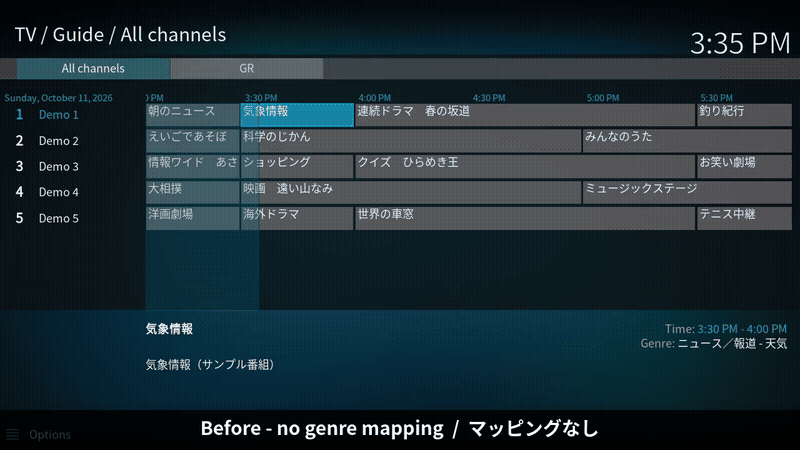

# Kodi genre mapping for Mirakurun

[日本語](README.ja.md)

A genre mapping file for Kodi's [IPTV Simple Client](https://github.com/kodi-pvr/pvr.iptvsimple) (`pvr.iptvsimple`) when it reads its TV guide from [Mirakurun](https://github.com/Chinachu/Mirakurun) (`/api/iptv/xmltv`).

Mirakurun writes Japanese ARIB genres such as `ニュース／報道 - 定時・総合`. Kodi doesn't know these, so every program shows up grey in the guide. This file maps each ARIB genre to the closest Kodi (DVB) genre, which gives you colour-coded programs while still showing the Japanese genre name.



Full video: [docs/demo.mp4](docs/demo.mp4) · Screenshots: [before](docs/before.png) / [after](docs/after.png)

## Files

| File | Description |
|---|---|
| [`genres/mirakurun-genres.xml`](genres/mirakurun-genres.xml) | Mapping file, English comments |
| [`genres/mirakurun-genres.ja.xml`](genres/mirakurun-genres.ja.xml) | Same mappings, Japanese comments |
| [`tools/gen_genres.py`](tools/gen_genres.py) | Generates both files from Mirakurun's source |
| [`demo/make_sample.py`](demo/make_sample.py) | Writes a sample M3U + XMLTV for testing without a tuner |

Both XML files contain identical mappings. Use whichever you prefer.

## Setup

1. Point IPTV Simple at Mirakurun:
   - **M3U playlist:** `http://<mirakurun>:40772/api/iptv/playlist`
   - **XMLTV:** `http://<mirakurun>:40772/api/iptv/xmltv`
2. Copy `mirakurun-genres.xml` to
   `userdata/addon_data/pvr.iptvsimple/genres/genreTextMappings/`
   ([where is userdata?](https://kodi.wiki/view/Userdata))
3. In the IPTV Simple settings, open the **EPG** tab. Under **Genres**:
   - **Use genre text from XMLTV when mapping genres**: on (keeps the Japanese genre names; turn off to see Kodi's English genre names instead)
   - **Location**: Local path
   - **Genres path**: the file from step 2
4. Restart the add-on. If the guide doesn't change, go to **Settings → PVR & Live TV → General → Clear data**.

Instead of copying the file, you can set **Location** to *Remote path* and **Genres URL** to:

```
https://raw.githubusercontent.com/MyFeetHurt/kodi-mirakurun-genres/main/genres/mirakurun-genres.xml
```

## How genres are mapped

Kodi only has the 11 DVB genre categories (EN 300 468), so each ARIB genre goes to the closest one:

| ARIB genre | Kodi category |
|---|---|
| ニュース／報道 | News / Current Affairs |
| スポーツ | Sports |
| 情報／ワイドショー | Show, Leisure |
| ドラマ, 映画 | Movie / Drama |
| 音楽 | Music |
| バラエティ | Show / Game Show |
| アニメ／特撮 | Children's (Cartoons) |
| ドキュメンタリー／教養 | Education / Science / Factual |
| 劇場／公演 | Arts / Culture |
| 趣味／教育 | Leisure / Hobbies, Education |
| 福祉 | Social / Political |
| 拡張 (CS extended genres) | Sports, Movie subgenres |

Some genres go to a different category from the rest of their group where that fits better. For example, `ニュース／報道 - 政治・国会` goes to Social/Political. Every line in the XML has a comment with the Kodi genre it maps to.

**Not mapped on purpose:**
- Broadcast notes such as `延長の可能性あり` (may be extended). Mirakurun lists them as categories next to the real genre. If they were mapped, they could override it.
- `その他 - その他` and `予備`. These programs show their genre text without a colour.

## Changing the mapping

Edit the tables in `tools/gen_genres.py` and regenerate both files:

```sh
git clone --depth 1 https://github.com/Chinachu/Mirakurun
python3 tools/gen_genres.py Mirakurun/src/Mirakurun/api/iptv/xmltv.ts genres
```

The script reads the genre text straight from Mirakurun's source, so the strings always match what Mirakurun outputs.

## Testing without a tuner

`demo/make_sample.py` writes `sample.m3u` and `sample-xmltv.xml` in Mirakurun's format with made-up channels and programs. Point IPTV Simple at them to try the mapping. This is how the demo video was recorded (Kodi 20.5, IPTV Simple 20.13.0).

```sh
python3 demo/make_sample.py /path/to/output
```

## Licence

[MIT](LICENSE)
